# 🤖 AgentForge — Visual AI Agent Builder (Next.js 16 + LangGraph)

<div align="center">


**Design an AI agent on a drag-and-drop canvas, give it real tools (web search, weather, GitHub, any API), chat with it while the answer streams in live, and share it with a link.**

</div>

---

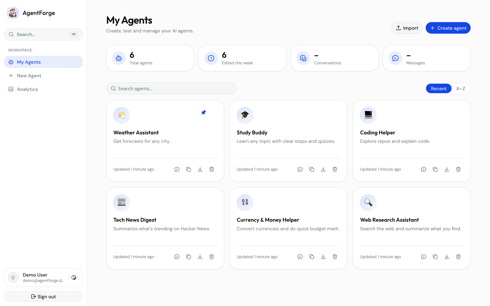

---

## 📋 Table of Contents

- [About](#-about)
- [Features](#-features)
- [Screenshots](#-screenshots)
- [Tech Stack](#-tech-stack)
- [Architecture](#️-architecture)
- [Folder Structure](#️-folder-structure)
- [Getting Started](#-getting-started)
- [Environment Variables](#-environment-variables)
- [Scripts, Tests & CI](#-scripts-tests--ci)
- [API Overview](#-api-overview)
- [How an Agent Run Works](#-how-an-agent-run-works)
- [Security Notes](#-security-notes)
- [Contributing](#-contributing)
- [Credits](#-credits)

---

## 📖 About

**AgentForge** lets you build AI agents without writing code.

- **Pick a template** (12 ready-made agents) or start from a blank canvas.
- **Shape the agent** on a visual Start → Agent → End canvas: write instructions, attach tools, toggle memory.
- **Chat with it** in a full-page chat with saved history, markdown replies and a live view of every tool call.
- **Share it** with one link. Visitors chat without signing in.
- **Any OpenAI-compatible model works** (OpenAI, Groq, Gemini, OpenRouter). Groq's free tier is enough to try everything.

---

## ✨ Features

| Feature | Description |
| --- | --- |
| 🔐 **Authentication** | Better Auth with **GitHub OAuth** and **email + password**. Friendly error messages for every failure |
| 🧩 **Visual Builder** | React Flow canvas (Start → Agent → End), tool picker, node settings, unsaved-changes guard, dark and light theme |
| 🛠️ **12 Built-in Tools** | Calculator, Weather, Web Search, Read Webpage, Wikipedia, Currency, Hacker News, Date & Time, and 4 GitHub tools (files, code search, PRs, diffs) |
| 🌐 **Custom HTTP Tools** | Connect any API: define params, headers and body from the UI |
| ⚡ **Streaming Chat** | Server-Sent Events, **Stop**, **Regenerate / Retry**, **Copy**, multi-line composer, markdown with tables and code |
| 🔎 **Tool Transparency** | Every tool call shows its status and an expandable **input / output** panel |
| 🗂️ **Chat History** | Conversations saved per agent: reopen, delete, export as `.md` |
| 🧠 **Agent Memory** | Toggle per agent. With memory off, every message starts fresh |
| 🛡️ **LangGraph Runtime** | Graph validation, max tool calls, max steps and a timeout. Hitting the tool limit degrades gracefully into an answer |
| ✨ **Improve with AI** | One click rewrites your agent's instructions, with **Undo** |
| 🔗 **Public Share Link** | `/share/<id>`: no login, rate-limited, GitHub and custom tools switched off, revocable |
| 📌 **Dashboard** | Pin, search, sort (Recent / A–Z), duplicate, **export / import** agents as JSON, usage stats, recent conversations |
| 📊 **Analytics** | Messages per day, most used tools, busiest agents (last 14 days) |
| ⌘ **Command Palette** | `Cmd/Ctrl + K` to jump to any agent, chat or page |
| 📱 **Responsive** | Desktop sidebar, mobile menu sheet, full-screen builder and chat on every screen size |
| 🧯 **Error Handling** | Provider errors become readable messages (secrets never reach the browser), retry panels, error boundaries |

---

## 🖼️ Screenshots

| Landing | Sign in |
| --- | --- |
| 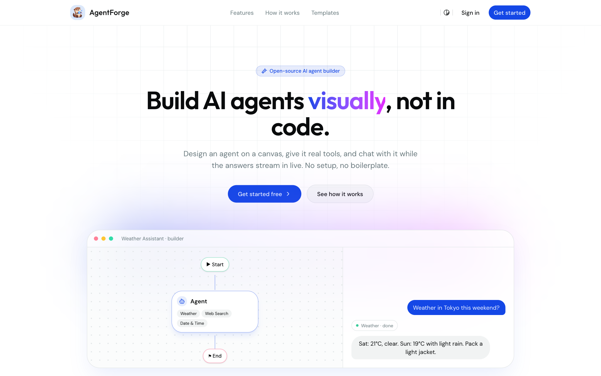 | 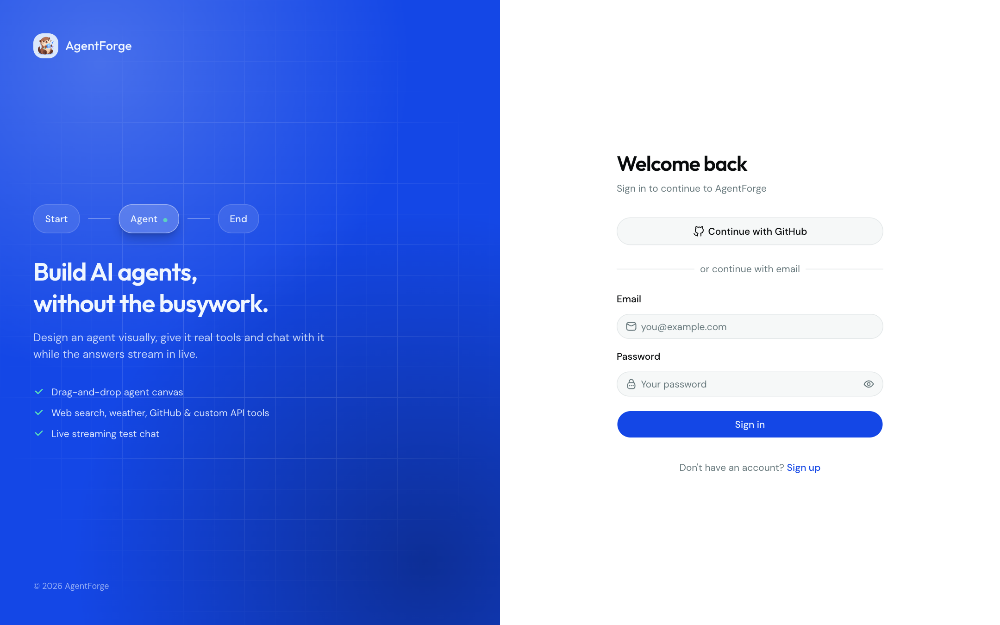 |

| Templates | Visual builder (dark) |
| --- | --- |
| 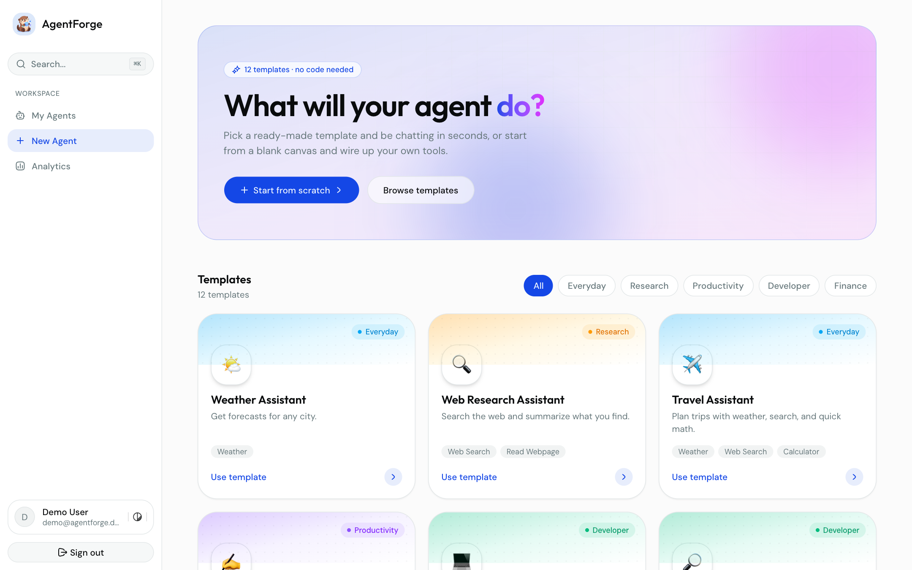 | 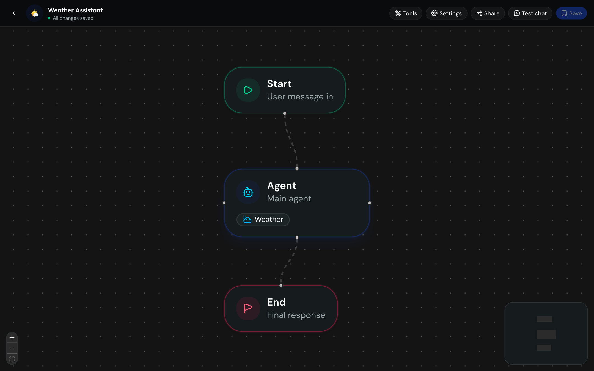 |

| Chat with tool details | Analytics |
| --- | --- |
| 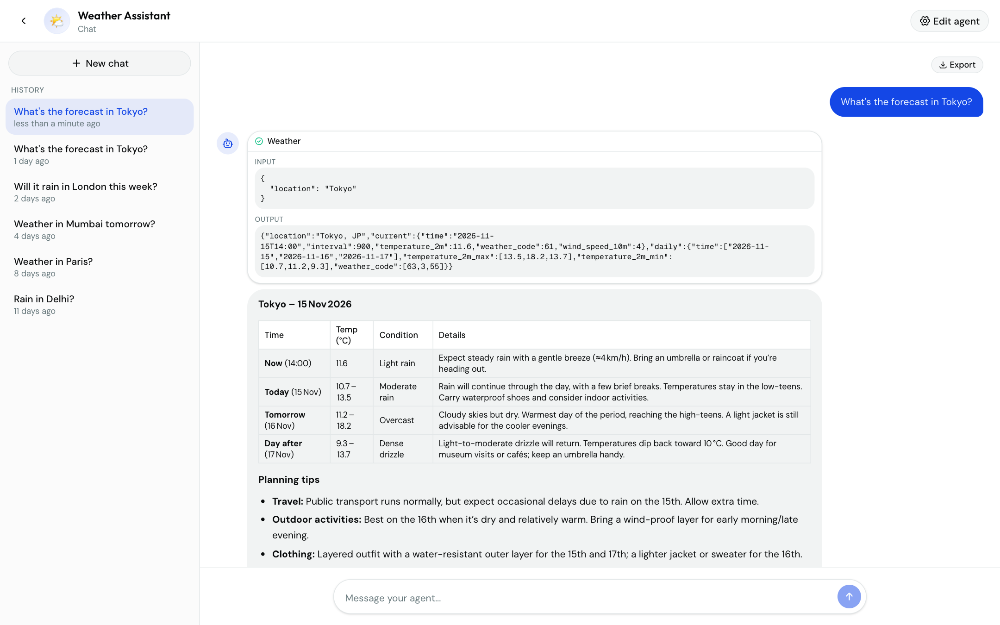 | 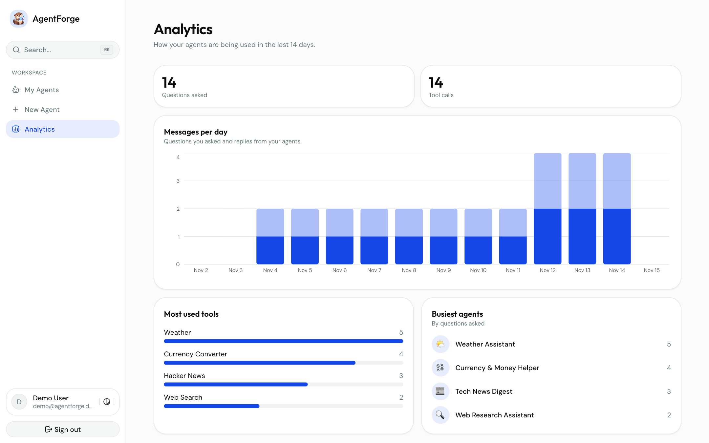 |

**Shared agent (public page)**

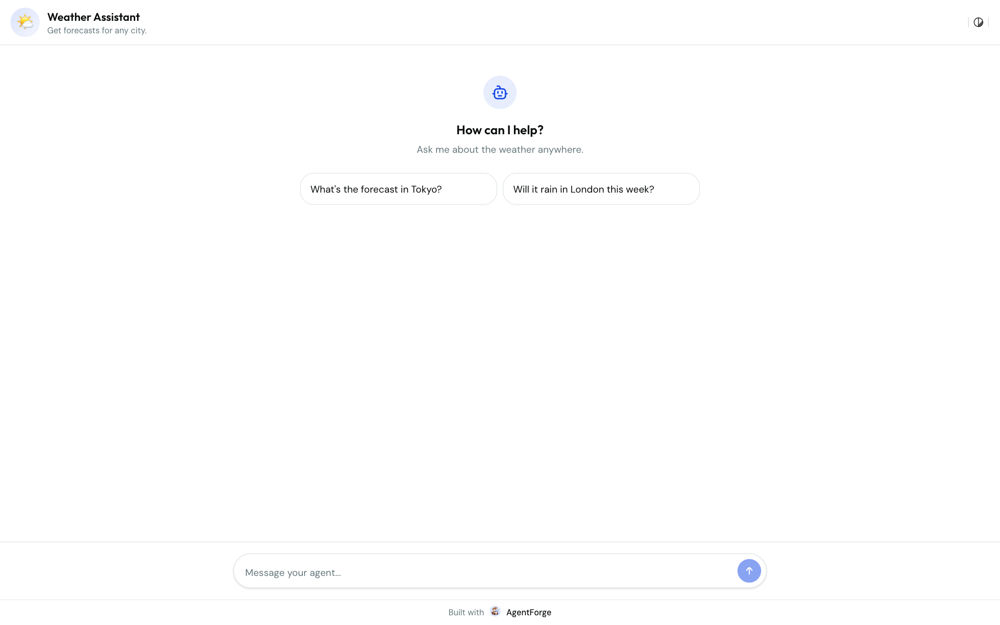

**Mobile**

<p>
  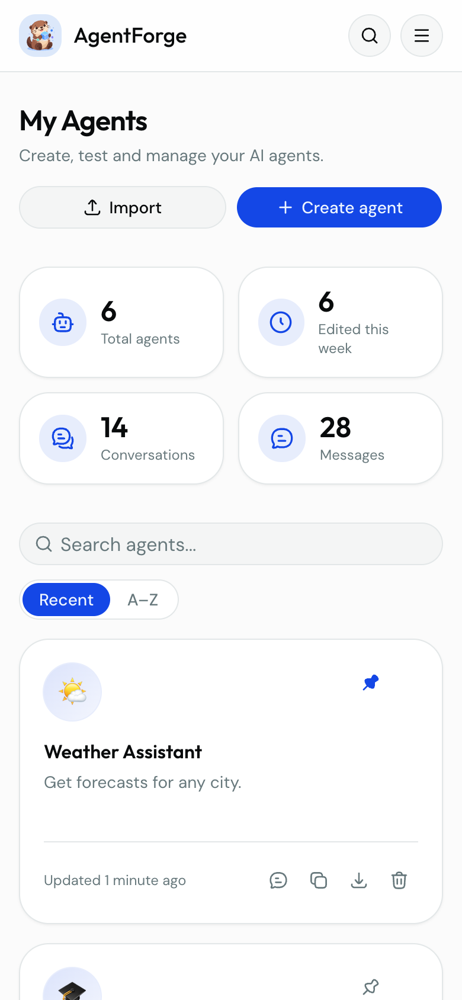
  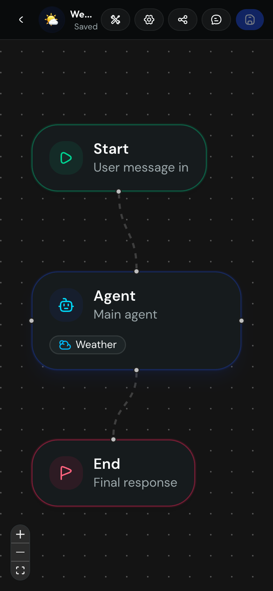
  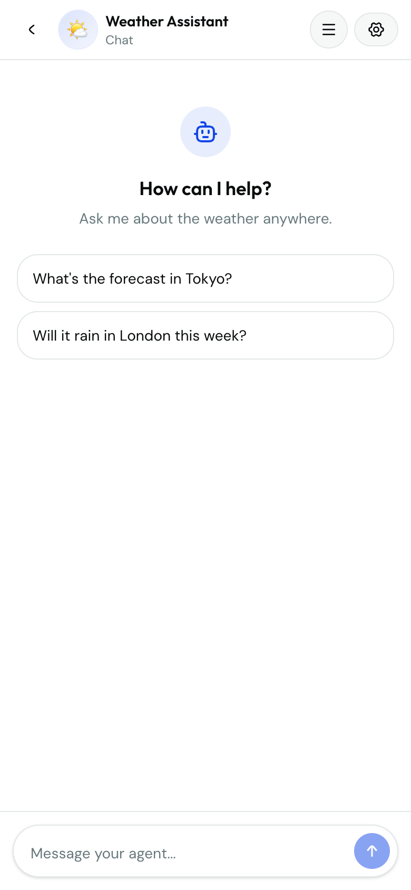
</p>

> The screenshots use a demo account. The analytics and history rows are sample data.

---

## 💻 Tech Stack

| Area | Tools |
| --- | --- |
| **Framework** | Next.js 16 (App Router, Turbopack), React 19, TypeScript (strict) |
| **UI** | Tailwind CSS 4, shadcn/ui (Base UI), Hugeicons, React Flow (`@xyflow/react`), Recharts, cmdk |
| **State & data** | TanStack Query, Zustand, Server Actions, Zod |
| **Agents** | LangChain, **LangGraph**, any OpenAI-compatible model, Tavily (web search), Open-Meteo, Wikipedia, GitHub REST API |
| **Backend** | PostgreSQL, Prisma 7 (with the `pg` driver adapter), Better Auth |
| **Quality** | ESLint with architecture-boundary rules, Vitest, knip (dead-code check), GitHub Actions |

---

## 🏗️ Architecture

AgentForge uses a **feature-based architecture** (conventions live in [`CLAUDE.md`](./CLAUDE.md)).

```
Browser                                  Next.js server                              External
┌──────────────────────────┐  actions   ┌───────────────────────────────┐   ┌────────────────────────┐
│ React 19 + TanStack Query│ ─────────► │ Server Actions (auth-checked) │ ─►│ PostgreSQL (Prisma)    │
│ features/ · shared/      │            │ Route handlers /api/*         │   │ Model provider (OpenAI │
│ Zustand (builder canvas) │ ◄───SSE─── │ LangGraph runtime + tools     │   │  / Groq / Gemini …)    │
└──────────────────────────┘            └───────────────────────────────┘   │ Tavily · Open-Meteo ·  │
                                                                            │ GitHub · Wikipedia …   │
                                                                            └────────────────────────┘
```

**Layering**, enforced by ESLint (`no-restricted-imports`), so cycles cannot creep back in:

```
app  →  features  →  shared
```

- `shared/` never imports `features/` or `app/`.
- Features import each other only along explicit edges (`builder → agents, playground`, `dashboard → agents, auth`,
  `runtime → tools`, …). The full list is in [`eslint.config.mjs`](./eslint.config.mjs).
- Code needed by two features moves to `shared/`. When a feature needs something from a sibling it may not import, it
  takes it as a prop (`ChatPanel` receives `getDefinition` from the builder).
- Server data lives in **TanStack Query** (calling Server Actions), client state in **Zustand**. Components never
  talk to Prisma.

---

## 🗂️ Folder Structure

```bash
agentforge/
│
├── app/                          # Routes only: thin pages that render a feature view
│   ├── (public)/                 #   landing · login · signup · share/[shareId]
│   ├── (private)/                #   agents · builder · chat · analytics (layout checks the session)
│   └── api/                      #   agents/[id]/runs · share/[id]/runs · ai/improve · auth
│
├── features/<name>/              # One folder per product feature
│   ├── views/                    #   page components (what a route renders)
│   ├── components/               #   feature-private UI
│   ├── hooks/                    #   TanStack Query hooks (UseXxx.ts)
│   ├── actions/                  #   Server Actions: the data-access layer (xxx.actions.ts)
│   ├── services/                 #   server logic and fetch clients (xxx.service.ts, xxx.tool.ts)
│   ├── store/ constants/ types/ util/
│   │   agents · analytics · auth · builder · dashboard · landing · playground · runtime · tools
│
├── shared/                       # Used by 2+ features
│   ├── components/               #   AppIcon · Logo · PageHeader · ErrorState · ui/ (shadcn)
│   ├── providers/                #   React Query + theme providers
│   ├── lib/                      #   db · auth · authClient · utils · generated Prisma client
│   └── types/ utils/             #   workflow schema, tool catalog, graph validation, error helpers
│
├── prisma/                       # schema.prisma + migrations
├── docs/                         # ENV_REFERENCE.md · screenshots/
├── .github/workflows/ci.yml      # typecheck · lint · test · knip · build
├── CLAUDE.md                     # naming + architecture conventions
└── README.md
```

More detail: [`shared/README.md`](./shared/README.md) · [`docs/ENV_REFERENCE.md`](./docs/ENV_REFERENCE.md)

---

## 🏁 Getting Started

### Prerequisites

- [Node.js](https://nodejs.org/) 22+ and [pnpm](https://pnpm.io/) 11+
- A **PostgreSQL** database. The fastest free option is `npx create-db` (Prisma Postgres) or [Neon](https://neon.tech)
- A model API key. [Groq](https://console.groq.com) has a free tier and works out of the box
- *(optional)* a [GitHub OAuth app](https://github.com/settings/developers) for GitHub sign-in and GitHub tools
- *(optional)* a [Tavily](https://tavily.com) key for the Web Search tool

### 1. Clone and install

```bash
git clone https://github.com/<your-username>/agentforge.git
cd agentforge
pnpm install        # also runs `prisma generate`
```

### 2. Configure the environment

```bash
cp .env.example .env
openssl rand -base64 32     # paste the result into BETTER_AUTH_SECRET
```

Then fill in `DATABASE_URL` and a model key. See [Environment Variables](#-environment-variables).

### 3. Create the database tables

```bash
pnpm exec prisma migrate deploy
```

### 4. Run it

```bash
pnpm dev        # http://localhost:3000
```

Sign up with email (or GitHub), pick a template and start chatting.

---

## 🔐 Environment Variables

Full reference: [`docs/ENV_REFERENCE.md`](./docs/ENV_REFERENCE.md).

| Variable | Required | Description |
| --- | --- | --- |
| `DATABASE_URL` | ✅ | PostgreSQL connection string (hosted databases: add `?sslmode=verify-full`) |
| `BETTER_AUTH_SECRET` | ✅ | Session signing secret (`openssl rand -base64 32`) |
| `BETTER_AUTH_URL` | ✅ | Public app URL (`http://localhost:3000` locally) |
| `OPENAI_API_KEY` | ✅ | Key for the model provider. Any OpenAI-compatible key works |
| `OPENAI_BASE_URL` | | Provider base URL, e.g. `https://api.groq.com/openai/v1` |
| `LLM_MODEL` | | Overrides the model for every agent, e.g. `openai/gpt-oss-120b` |
| `GITHUB_CLIENT_ID`, `GITHUB_CLIENT_SECRET` | | GitHub sign-in and GitHub tools. Callback URL: `<BETTER_AUTH_URL>/api/auth/callback/github` |
| `TAVILY_API_KEY` | | Enables the Web Search tool |

**Free setup with Groq:**

```bash
OPENAI_API_KEY="gsk_..."
OPENAI_BASE_URL="https://api.groq.com/openai/v1"
LLM_MODEL="openai/gpt-oss-120b"
```

> Free tiers have token-per-minute limits. The runtime waits out short rate limits and retries automatically, and it
> caps tool output so one web page cannot use up the whole budget.

---

## 🧪 Scripts, Tests & CI

| Command | What it does |
| --- | --- |
| `pnpm dev` | Next.js dev server (Turbopack) |
| `pnpm typecheck` | `tsc --noEmit` (strict) |
| `pnpm lint` | ESLint, including the **architecture-boundary rules** |
| `pnpm test` | Vitest: error mapping, tool catalog, graph validation, and an integrity check of every agent template |
| `pnpm knip` | Dead-code check: unused files, exports and dependencies |
| `pnpm build` | Production build |
| `pnpm db:migrate` | `prisma migrate dev` (create a new migration) |
| `pnpm db:studio` | Prisma Studio |

GitHub Actions ([`ci.yml`](./.github/workflows/ci.yml)) runs typecheck, lint, tests, knip and build on every push and
pull request.

> After you change `prisma/schema.prisma`: add a migration, run `pnpm exec prisma generate`, and **restart `pnpm dev`**
> (the dev server keeps the old Prisma client in memory).

---

## 🔌 API Overview

Most data access uses **Server Actions** (checked with the session and filtered by `userId`). HTTP endpoints exist where
streaming or public access is needed.

| Endpoint | Auth | Purpose |
| --- | --- | --- |
| `POST /api/agents/[agentId]/runs` | session | Run an agent and stream the answer (SSE). Supports `regenerate` |
| `POST /api/share/[shareId]/runs` | public | Chat with a shared agent. Rate-limited, safe tools only, nothing stored |
| `POST /api/ai/improve` | session | Rewrite agent instructions with AI |
| `GET/POST /api/auth/*` | | Better Auth (email, GitHub OAuth, sessions) |

SSE events: `text_delta` · `tool_started` · `tool_completed` · `run_completed` · `run_failed`.

---

## 🔄 How an Agent Run Works

```
User message → Start node → Agent node ⇄ tools (loop) → End node → streamed reply
```

1. The builder canvas is saved as a **graph definition** (Zod-validated). Older v1 agents are migrated on load.
2. `validateGraph` checks the graph, then `compileWorkflow` builds the **LangGraph** workflow.
3. The agent node streams the model's reply. When the model calls a tool, the result (capped in size) is fed back, up to
   the agent's tool-call limit. After the limit, the model answers with what it has.
4. Recoverable provider problems (a malformed tool call, a short rate limit) are retried. Anything else becomes a
   friendly error. The raw error is logged on the server only.

---

## 🛡️ Security Notes

- Every Server Action and route handler checks the session and filters by `userId`.
- **Shared agents** run with GitHub tools and custom HTTP tools removed, so a visitor can never use the owner's token or
  secret headers. Visitors are rate-limited per IP (in-memory: it resets on restart and is per server instance, so use
  a shared store such as Redis if you deploy several instances).
- Exported agent files can contain custom-tool headers (for example API keys). Treat them as secrets.
- Raw model or provider errors are never sent to the browser.

---

## 🤝 Contributing

1. Fork the repository and create a branch: `git checkout -b feature/your-feature`
2. Read [`CLAUDE.md`](./CLAUDE.md) for the naming and layering rules
3. Run `pnpm typecheck && pnpm lint && pnpm test && pnpm knip`
4. Commit (`git commit -m "feat: your change"`), push, and open a Pull Request

---

## 🙌 Credits

AgentForge started from the open-source tutorial project
[`agent-builder-yt`](https://github.com/Aestheticsuraj234/agent-builder-yt) by Suraj Jha (*"Stop Paying for AI Agent
Builders. I Built My Own in 3.5 Hours"*). It was then extended with the features, architecture and tests described
above.

<div align="center">
  Made with ❤️ by <a href="https://github.com/singhayush007">Ayush Singh</a>
</div>
